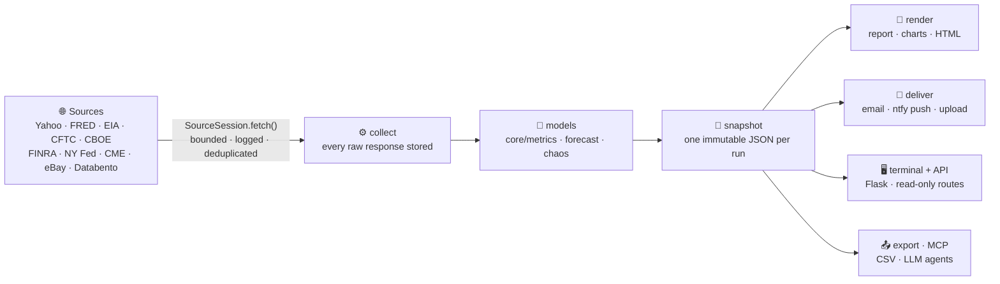

<div align="center">


# Market Terminal

**A point-in-time market-stress and options-positioning record that you run yourself.**<br>
Every raw response stored · one immutable snapshot per run · models that cite their sources · missing is never zero

[](https://github.com/vladbondarenko97/market-terminal/actions/workflows/test.yml)


[](LICENSE)


**[For quants](docs/for-quants.md) · [For traders](docs/for-traders.md) · [For teams](docs/for-teams.md) · [Methodology](docs/methodology.md) · [All docs](docs/README.md)**

</div>

Market Terminal is a Python and SQLite system. Three times each NYSE trading day it pulls from about a dozen market
and macro sources, stores every raw response, computes published models and commits one immutable snapshot. A
browser terminal, an email, a phone push, an HTTP API and an MCP server all read that snapshot. There is no cloud
account and no hosted database.

> Not financial advice. Every model output is an estimate or a probability, and each card states its own caveats.

## 📍 2026-10-30: the stress flip, as recorded

The Chaos / Peace index averages 12 stress z-scores (VIX term structure, VVIX, SKEW, MOVE, credit, realised vol,
drawdown, put/call, short volume, policy uncertainty). On a Friday when SPY closed down 2.3% and VIX rose from 17.2
to 21.1, it moved through the session like this:

| Run (CT) | Score | Regime | What the system did |
|---|--:|---|---|
| Thu 14:45 | −3.2 | neutral | — |
| Fri 08:31 | 7.5 | neutral | SPY short-volume share at z 1.26 |
| Fri 11:30 | 24.3 | neutral | **Warning with a record on:** "score in the upper quarter of neutral (15 to 30)". Since 1992 it was followed by stress within 20 days 38.9% of the time, against a 12.3% base rate (n = 54, t = 4.0). The condition was fixed in code on 2026-10-10 and has not been tuned since. Most of that history is an index of 5 to 9 components (12 only from 2026-09-16), so the same 30 line is not the same distance in every era. |
| Fri 14:45 | **30.5** | **stress** | Regime change recorded. Phone alert at 14:50, ten minutes before the close. Drivers: VVIX, short volume, VIX/VIX3M. |

The same runs printed an engine ticket of **BULLISH +3**. The terminal showed both readings and did not merge them
into one verdict.

**What this is and is not.** The index measures stress while it happens. It is not a forecast, and one day is an
anecdote. What makes it useful is the record: every intraday reading is stored with the time it became known, so the
day can be replayed exactly. → [Full case study, with run IDs](docs/case-study-2026-10-30.md)

## Who it's for

| You are | You get | Start |
|---|---|---|
| **Quant / researcher** | Point-in-time observations with knowledge time (`fetched_at`), revisions kept as new rows, immutable snapshots, CSV export, models with versions and citations, an explicit evidence gate | [For quants](docs/for-quants.md) |
| **Trader** | One screen for the stress regime, dealer gamma and walls, implied vs forecast volatility, and rule alerts that say "Buy" only for rows with measured evidence (standard size when `tested`, half size when `thin`) | [For traders](docs/for-traders.md) |
| **Fund / desk / team** | A self-hosted collector you can audit end to end, read-only integration points (SQLite, HTTP, MCP), additive schema, offline CI | [For teams](docs/for-teams.md) |
| **Curious** | A plain-English explanation of every card and term | [Guide](docs/guide.md) |

## What it measures

| Family | Signals | Source |
|---|---|---|
| **Market stress** | Chaos / Peace index (12 components, daily history back to 1930, stress episodes, an onset study, an election event study), VMRI | CBOE, ICE BofA (FRED), FINRA, policy uncertainty, Yahoo |
| **Options positioning** | Dealer gamma (GEX) profile, zero-gamma level, call and put walls (3 nearest listed expirations; for SPY that is 0 to 2 DTE, so monthly open interest is not included), max pain, Breeden-Litzenberger implied distribution | Captured option chains |
| **Volatility and trend** | HAR-RV forecast vs implied, time-series momentum with flip levels, mechanical flows (vol control, leveraged ETFs, CTAs) | Daily OHLC |
| **Positioning and flow** | CFTC COT index, SLV trust ounces, dark-pool block prints with the feed's own sides | CFTC, iShares, Databento (optional) |
| **Rates and funding** | NY Fed repo and reverse repo, SOFR, TGCR, BGCR, EFFR, Treasury buybacks and auctions, recession probit, NFCI, Sahm rule | NY Fed, Treasury, FRED |
| **Energy** | Crack spreads, EIA stocks against the 5-year norm, refinery runs, Texas refinery outage filings | EIA, TCEQ, CFTC |
| **Silver** | COMEX registered and eligible, paper:physical ratio, Shanghai–COMEX spread paired by date, Silver Eagle retail premium | CME, SGE, eBay |
| **Calendar** | FOMC, CPI, payrolls and other release-day drift, OPEX, turn of month, all graded by the evidence gate | FRED release calendars, the Fed |

Every computed value, with its version and method: [Methodology](docs/methodology.md).

## Integrate it

```bash
.venv/bin/python main_pipeline.py export --metric chaos. --since 2026-01-01 --out chaos.csv
```

```python
import pandas as pd
df = pd.read_csv("chaos.csv", parse_dates=["observed_at", "fetched_at"])
known = df[df.fetched_at <= pd.Timestamp("2026-10-30 17:00", tz="UTC")]   # only what was known at noon CT
```

| Way in | For |
|---|---|
| `main_pipeline.py export` → CSV | Notebooks and backtests. Read-only. |
| SQLite `portfolio.db` (`v2_observations`, `v2_snapshots`, `v2_payloads`) | Full history, raw captures and lineage ([Data](docs/data.md)) |
| HTTP JSON API | Dashboards and internal tools ([API](docs/api.md)) |
| MCP server | LLM agents: read-only sources, docs and model code ([Operations](docs/operations.md#mcp-server-claude-chat-chatgpt-gemini-cli)) |

## Why you can trust a number on it

- 🧾 **Missing is never zero.** A failed source is reported as missing, with the reason, on the card that needed it.
  There are no fallback constants for observed market data, and no placeholders or carried-forward prices.
- 🕰️ **Point-in-time.** Observations carry `observed_at` and `fetched_at`. A revision is a new row. Snapshots are
  protected by database triggers against `UPDATE` and `DELETE`.
- 🔁 **Replayable.** Any past run re-renders from its stored snapshot with no network (`main_pipeline.py replay`), and the
  report text is byte-identical. Raw responses are stored separately, deduplicated by SHA-256, for audit.
- 🧪 **Evidence before action.** A rule only says "Buy" when its own history passes a fixed test, and there are two. The Day Scanner and
  Edge Lab use `core/watch.py grade()`: enough cases, a better result than baseline in both halves, and t ≥ 2. The
  fair-value, momentum and positioning rows of Signal Watch use a lighter one: a win rate 5 points over baseline and
  at least 30 cases, with no t-test. Otherwise the card says there is no measured edge.
- 📚 **Published models.** Breeden-Litzenberger, HAR-RV (Corsi 2009), time-series momentum
  (Moskowitz-Ooi-Pedersen 2012) and the NY Fed recession probit. Forecasts are logged and graded later by hit rate,
  coverage and Brier score.
- 🏷️ **Versioned definitions.** A value that changes meaning gets a new model version and a line in
  [value-changes](docs/value-changes.md).
- 🤖 **AI agents kept on rails.** Coding agents work under one rulebook, [AGENTS.md](AGENTS.md), and CI checks the
  rules a machine can check. [See what they caught ↓](#-incidents-and-the-guards-they-left-behind)

## How it works



1. **Collect.** Every pipeline network call goes through `SourceSession.fetch()`. It deduplicates, bounds, logs and
   stores each request, and in offline runs it makes no calls at all. The CME download is the exception: it uses
   `cme.fetch_bounded` (raw requests, offline-guarded, payload stored).
2. **Compute.** Models run in the pipeline, so a stored number on screen is the number in the snapshot. A few panels,
   such as option analytics and Edge Lab, compute live; the [API](docs/api.md#data-sources-and-writes) lists which.
3. **Snapshot.** One immutable document per run. The SQLite store only ever adds: no table, column or row is dropped.
4. **Serve.** The terminal, API, export and MCP server all read stored data.

## 🔍 Case study: the benchmark that wasn't

> **TL;DR:** The Silver Eagle premium chart looked plausible, but 69 of its 325 rows had been computed against a silver
> price frozen at $67.80. Rebuilding the series from prices recorded in the same run took the stored range of
> **−2.1% to +39.0%** down to the real **8.2% to 20.7%**.

The old ledger divided each retail price by a futures price. In 69 of 325 rows that futures price was a fixed $67.80,
and many other rows took it from an earlier moment than the retail price. A fresh price divided by an old one is noise
that looks exactly like a premium. `/api/arbitrage_history` now pairs each retail price with the silver price **of
the same run**, and the card's statistics are computed in the pipeline. The old rows are history and are not
rewritten; [Known issues](docs/known-issues.md) records the problem. That set the rule that a spread is only drawn
from two prices of the same run or date. The Shanghai–COMEX spread follows it too.

## 🧯 Incidents and the guards they left behind

Each production problem ended with a test or a rule that makes the same mistake fail the build next time.

| What broke | Root cause | Guard now in place |
|---|---|---|
| CI went red on 2026-10-14 with no code change | A backfill test only passed while its fixture date was inside a window counted back from today | **CI runs the whole suite a second time with the clock 400 days ahead** ([`tests/shifted_clock.py`](tests/shifted_clock.py)). It found three more tests that would have broken within 200 days. |
| Tests quietly called FINRA, the EIA, the Treasury and Yahoo | A test exercised the collector without replacing every fetcher | **Any network connection during tests raises `NetworkBlocked`** ([`tests/support.py`](tests/support.py)), a `BaseException` so a source wrapper cannot swallow it |
| The daily Briefing was missing on every CASH day | The note writer assumed an engine ticket was always a dict | A test feeds the note writer the ticket in each shape the engine produces |
| Every Yahoo symbol showed "possibly delisted" on 2026-10-16 | A test run saved an empty login cookie into yfinance's shared cache, dated a year ahead, and the live server kept reusing it | **Tests get their own yfinance cache**, set up in `tests/support.py` before any test runs |

## Run it

No account and no key is needed for the first run. Tested on Python 3.13 and 3.14.

```bash
git clone https://github.com/vladbondarenko97/market-terminal.git
cd market-terminal
python3 -m venv .venv && .venv/bin/pip install -r requirements.txt

.venv/bin/python main_pipeline.py run --no-deliver --no-cme-browser   # first run, 1 to 2 minutes; sends nothing
.venv/bin/python options_whale/api_router.py                          # then open http://localhost:8080
```

The first run creates `CME_Data/` inside the project folder: one SQLite database plus a folder per day. It is
git-ignored, so your data never reaches a commit. The scorecard and the history charts fill in as the days pass.

On a Mac, `./setup.sh` does the install and keeps the terminal running as a login service with a menu bar icon.
`./setup.sh --schedule` (on **one** Mac only) runs the pipeline three times a trading day and checks the rule alerts
every 15 minutes of the session. It is safe to re-run; `./setup.sh --help` lists every option. Details:
[Operations](docs/operations.md).

### What each key adds

Everything is optional. Copy `.env.example` to `.env` (`setup.sh` does it) and fill in what you want;
[Configuration](docs/configuration.md) lists every setting and what happens when it is empty.

| You add | Cost | You get |
|---|---|---|
| nothing | free | Forecast Lab (models, Signal Watch, Day Scanner, Edge Lab), Chaos / Peace (8 of 12 components; 10 after `scripts/backfill_chaos_history.py`), Time Arbitrage, dealer gamma, the Shanghai–COMEX spread, engine tickets |
| `FRED_API_KEY` | free | The VMRI risk index and War Room, Fed liquidity, the macro inputs of Forecast Lab cards 5 to 7, the HY spread and policy-uncertainty components of Chaos / Peace |
| A CME account (`main_pipeline.py cme-login`) | free | COMEX volume files, inventory and the paper:physical ratio |
| `EBAY_APP_ID`, `EBAY_CERT_ID` | free | Silver Eagle premiums over silver futures, the dealer book and units sold between runs |
| `NTFY_URL`, the email settings | free | The phone push, the rule alerts and the email report |
| A local model server (Ollama, oMLX, LM Studio) | free | The console: ask the terminal in plain words |
| `DATABENTO_API_KEY` | paid | Dark-pool block flow |

The repository does not include a database or a sample run, and it should not: several sources (CME, Databento,
eBay) have their own terms on passing their data on. If you fork it, keep `CME_Data/` and `.env` out of git the same way.

## What you get

<details>
<summary><b>The terminal: three tabs</b></summary>

- **Macro Direction**: the VMRI macro risk index and War Room scenarios; COMEX registered, eligible and total silver
  with the paper:physical ratio against its own recorded range; the Silver Eagle premium over futures with its
  z-score, what moved it, a dealer book and units sold; the Shanghai–COMEX spread, each fix paired with the
  COMEX and USD/CNY close of the same date; dealer gamma (GEX), block flow with the feed's trade sides kept
  apart from guessed ones, catalyst calendar, news sentiment, Fed liquidity and the Engine Positions card.
- **Time Arbitrage**: option analytics for a ticker: dealer positioning, IV vs realised volatility, term structure, a
  probability matrix and an option chain explorer with a Black-Scholes calculator.
- **Forecast Lab**: model cards for SPY or SLV: market-implied range, volatility forecast, trend/CTA,
  positioning (COT), silver fair value, macro regime, calendar effects, mechanical flows, a forecast scorecard,
  diesel & refining (with a Texas refinery outage tracker), EIA inventories, a Chaos / Peace stress index with
  history back to 1930, election markers and a regime watch, and Fed / Treasury operations. Three rule cards sit
  beside them: **Signal Watch** (every trigger, fired or waiting, with what to do), **Day Scanner** (a
  dip-in-an-uptrend rule on your own ticker list) and **Edge Lab** (published edges tested on any ticker's own
  history).

</details>

<details>
<summary><b>Around the terminal</b></summary>

- **Three runs a day** on NYSE trading days (09:31, 12:30 and 15:45 ET; no afternoon run on 13:00 ET early closes).
- **Rule alerts**: every 15 minutes of the session, a trigger that goes from waiting to fired is pushed to your phone once.
- **Console**: ask in plain words ("where are the gamma walls?"). A model on your own machine answers from the
  terminal's read-only routes; nothing leaves the computer.
- **Execution engine and position tracking**: each run outputs a trade ticket (or CASH). Tickets are stored and
  marked at +1 day, +1 week and +2 weeks.
- **Delivery**: an email report, a phone push (ntfy) and an optional upload to your own web server. The exact email is
  saved before it is sent, and a bounce reported later by the recipient's server is caught and recorded.
- **Menu bar control**: a macOS menu bar icon shows whether the server is up and starts, stops or restarts it.

</details>

<details>
<summary><b>Tests: 502, offline, about a minute</b></summary>

Plain `unittest`. No network, no credentials and a scratch data folder, so they pass on a fresh clone and in CI
(Ubuntu, on every push and pull request, and once a day because `requirements.txt` is not pinned, so a new release
of a dependency shows up as a red badge within a day). CI runs the suite a second time with the clock 400 days ahead.

```bash
.venv/bin/python -m unittest discover -s tests
.venv/bin/python tests/shifted_clock.py 400                       # needs: pip install time-machine
for f in options_whale/static/*.js; do node --check "$f"; done    # syntax check of the terminal's scripts
```

| File | Tests | What it protects |
|---|:-:|---|
| `test_api.py` | 94 | Every terminal route: `/help` lists them all, bad parameters are refused, run control, gamma, dark pool, War Room and option maths, JSON that never carries `NaN` |
| `test_v2.py` | 54 | The acceptance rules: a failed source is reported and never shown as zero, outputs match the snapshot, the evidence test behind the rule cards, a console that can only read |
| `test_pipeline_fixes.py` | 42 | Settings parsing, the data folder rules, the run lock, exit codes, delivery results, the CSV export, one offline run end to end |
| `test_core_fixes.py` | 39 | Storage that only ever adds, request limits, CME downloads, engine tickets and their marks, the scorecard, models with missing inputs |
| `test_fedops.py` | 35 | Fed and Treasury operations: repo, reference rates, buybacks, auctions, revisions |
| `test_ui.py` | 31 | The page without a browser: every element a script touches exists, the menu drawer, the phone layout |
| `test_narrative.py` | 31 | The analyst note: the brief, its validator, the pipeline stage, replay, the read-only query command |
| `test_chaos.py` | 25 | The Chaos / Peace index: the model on seeded series, its fetchers on saved responses, the stored route |
| `test_chaos_history.py` | 23 | The long Chaos / Peace history: episodes, the regime study, election markers, frozen past days |
| `test_news.py` | 22 | The news store and the release calendar: the feed reader, headline clustering, release-day rows |
| `test_backfill.py` | 20 | The backfill scripts, Fed speech days and SEC Form 4 with the insider cluster edge |
| `test_schedule.py` | 18 | NYSE holidays and early closes, which scheduled runs are accepted, the launchd times `setup.sh` writes |
| `test_card_stats.py` | 17 | The Silver Eagle premium statistics, units sold between runs, the paper:physical history |
| `test_mcp_server.py` | 12 | The MCP server: each secret path gets only its tools, tokens never logged, unknown sources refused without a request |
| `test_console_guards.py` | 11 | The console refuses to answer with figures it did not fetch |
| `test_shanghai.py` | 10 | The date-paired Shanghai spread: no pair without all three prices of one date |
| `test_deploy.py`, `test_brokerage.py`, `test_bounces.py` | 18 | `scripts/deploy.sh` against throwaway repos, brokerage holdings, bounced email detection |

`scripts/record_demo.py` re-records the GIF above from a running terminal.

</details>

## Documentation

Everything is indexed in **[docs/README.md](docs/README.md)**, by reader and by task. The most used pages:
[Operations](docs/operations.md) · [Configuration](docs/configuration.md) · [Methodology](docs/methodology.md) ·
[Forecast Lab](docs/forecast-lab.md) · [Data](docs/data.md) · [API](docs/api.md) · [Guide](docs/guide.md) ·
[Architecture](docs/architecture.md) · [Known issues](docs/known-issues.md) · [AGENTS.md](AGENTS.md)

## Security and platform

The terminal server has no authentication. It listens on `127.0.0.1` (this Mac only) unless `OPTIONS_WHALE_HOST=0.0.0.0`
opens it to every network interface, which is how other devices reach it without a reverse proxy. Either way, keep
whatever reaches it on a private network (for example Tailscale) and off the internet.

macOS. The CME browser login, the Mail import, the launchd services and the menu bar icon are Mac-specific. The tests
and offline runs (`main_pipeline.py run --offline`) also work on Linux, which is where CI runs them.

## License

MIT. See [`LICENSE`](LICENSE).
