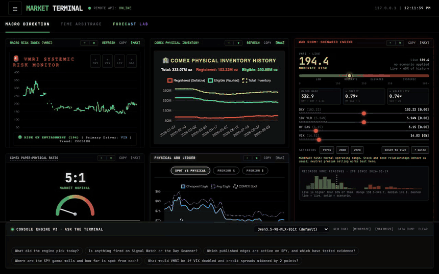
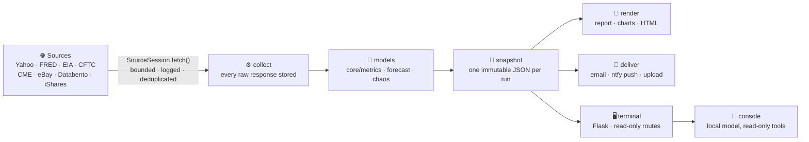

<div align="center">


# Market Terminal

**A self-hosted market desk: collect twice a day, keep every raw byte, and never show a number it can't stand behind.**

[](https://github.com/vladbondarenko97/market-terminal/actions/workflows/test.yml)


[](LICENSE)



</div>

Market Terminal is a Python and SQLite system that runs on one Mac. Three times each trading day a pipeline pulls
from about a dozen market sources and stores every raw response. It then computes quantitative models and commits one
immutable snapshot. A browser terminal, an email report and a phone push read that snapshot. There is no cloud
account and no hosted database, and a local model answers questions about it in plain words without
anything leaving the machine.

> Not financial advice. Every model output is a probability or an estimate, and each card states its own caveats.

## Why it matters

- 🧾 **Missing is never zero**: A source that fails is reported as missing, with the reason, on the card that needed it.
  There is no fallback constant, no placeholder and no carried-forward price. A split that is a guess is drawn as one.
- 🧪 **Evidence before action**: A rule only says "buy" when its own history passes a fixed test: enough cases, the same
  sign in both halves of the record, and a t-statistic of at least 2. Otherwise the card says there is no measured edge.
- 📚 **Published models, not vibes**: The Forecast Lab uses methods from the literature, among them the options-implied
  distribution (Breeden-Litzenberger), HAR-RV volatility (Corsi 2009) and time-series momentum
  (Moskowitz-Ooi-Pedersen). Forecasts are stored and graded later on a scorecard.
- 🔁 **Reproducible to the byte**: Each run's provider responses are stored, deduplicated by SHA-256, and any past run
  re-renders from its snapshot with no network (`main_pipeline.py replay`).
- 🤖 **AI agents, kept on rails**: Coding agents work on this repository under one rulebook,
  [AGENTS.md](AGENTS.md): ten hard rules shared by Claude Code, Codex and Cursor. The rules that can be checked by a
  machine are checked in CI, so an agent that breaks one fails the build. [See what they caught ↓](#-incidents-and-the-guards-they-left-behind)
- 🔒 **Yours alone**: The repository holds code only. Your data folder is git-ignored, the terminal stays on your private
  network, and the console's model runs on your own machine with read-only access.

## How it works



1. **Collect.** Every network call goes through one gate, `SourceSession.fetch()`. It deduplicates, bounds, logs and
   stores each request, and in offline runs it makes no calls at all.
2. **Compute.** Models run in the pipeline, so a stored number on screen is the number in the snapshot. A few panels,
   such as option analytics and Edge Lab, compute live; [API](docs/api.md#data-sources-and-writes) lists which.
3. **Snapshot.** One immutable document per run. The SQLite store only ever adds: no table, column or row is dropped.
4. **Serve.** The terminal reads stored data. A computed value that changes meaning gets a new model version and a line
   in [value-changes](docs/value-changes.md), so a chart never mixes two definitions without saying so.

## 🔍 Case study: the benchmark that wasn't

> **TL;DR:** The Silver Eagle premium chart looked plausible, but 69 of its 325 rows had been computed against a silver
> price frozen at $67.80. Rebuilding the series from prices recorded in the same run took the stored range of
> **−2.1% to +39.0%** down to the real **8.2% to 20.7%**.

**What we saw.** The stored premium of retail Silver Eagles over futures ranged from −2.1% to +39.0%, far wider than
dealers' prices moved.

**Root cause.** The old ledger divided each retail price by a futures price, but that futures price was a fixed
$67.80 in 69 of 325 rows, and many other rows took it from an earlier moment than the retail price. A fresh price
divided by an old one is noise that looks exactly like a premium.

**The fix.** The terminal no longer reads the old premium columns. `/api/arbitrage_history` pairs each retail price
with the silver price **of the same run**, and the card's statistics (z-score, 90-day range, units sold between runs)
are computed in the pipeline and stored with the snapshot. The old rows are history and are not rewritten, so the
problem is recorded in [Known issues](docs/known-issues.md) for any other reader of that file.

**The pattern it set.** A spread is only drawn from two prices of the same run or the same date. The Shanghai–COMEX
spread follows the same rule: each Shanghai fix is paired with the COMEX and USD/CNY close of its own date, and nothing
is carried forward.

## 🧯 Incidents and the guards they left behind

Each production problem ended with a test or a rule that makes the same mistake fail the build next time.

| What broke | Root cause | Guard now in place |
|---|---|---|
| CI went red on 2026-10-14 with no code change | A backfill test only passed while its fixture date was inside a window counted back from today | **CI runs the whole suite a second time with the clock 400 days ahead** ([`tests/shifted_clock.py`](tests/shifted_clock.py)). It found three more tests that would have broken within 200 days. |
| Tests quietly called FINRA, the EIA, the Treasury and Yahoo | A test exercised the collector without replacing every fetcher | **Any network connection during tests raises `NetworkBlocked`** ([`tests/support.py`](tests/support.py)), a `BaseException` so a source wrapper cannot swallow it |
| The daily Briefing was missing on every CASH day | The note writer assumed an engine ticket was always a dict | A test feeds the note writer the ticket in each shape the engine produces |
| Every Yahoo symbol showed "possibly delisted" on 2026-10-16 | A test run saved an empty login cookie into yfinance's shared cache, dated a year ahead, and the live server kept reusing it | **Tests get their own yfinance cache**, set up in `tests/support.py` before any test runs |

## Run it

No account and no key is needed for the first run. Tested on Python 3.13 and 3.14.

```bash
git clone https://github.com/vladbondarenko97/market-terminal.git
cd market-terminal
python3 -m venv .venv && .venv/bin/pip install -r requirements.txt

.venv/bin/python main_pipeline.py run --no-deliver --no-cme-browser   # first run, 1 to 2 minutes; sends nothing
.venv/bin/python options_whale/api_router.py                          # then open http://localhost:8080
```

The first run creates `CME_Data/` inside the project folder: one SQLite database plus a folder per day. It is
git-ignored, so your data never reaches a commit. The scorecard and the history charts fill in as the days pass.

On a Mac, `./setup.sh` does the install and keeps the terminal running as a login service with a menu bar icon.
`./setup.sh --schedule` (on **one** Mac only) runs the pipeline three times a trading day and checks the rule alerts
every 15 minutes of the session. It is safe to re-run; `./setup.sh --help` lists every option. Details:
[Operations](docs/operations.md).

### What each key adds

Everything is optional. Copy `.env.example` to `.env` (`setup.sh` does it) and fill in what you want;
[Configuration](docs/configuration.md) lists every setting and what happens when it is empty.

| You add | Cost | You get |
|---|---|---|
| nothing | free | Forecast Lab (models, Signal Watch, Day Scanner, Edge Lab), Time Arbitrage, dealer gamma, the Shanghai–COMEX spread, engine tickets |
| `FRED_API_KEY` | free | The VMRI risk index and War Room, Fed liquidity, the macro inputs of Forecast Lab cards 5 to 7 |
| A CME account (`main_pipeline.py cme-login`) | free | COMEX volume files, inventory and the paper:physical ratio |
| `EBAY_APP_ID`, `EBAY_CERT_ID` | free | Silver Eagle premiums over silver futures, the dealer book and units sold between runs |
| `NTFY_URL`, the email settings | free | The phone push, the rule alerts and the email report |
| A local model server (Ollama, oMLX, LM Studio) | free | The console: ask the terminal in plain words |
| `DATABENTO_API_KEY` | paid | Dark-pool block flow |

The repository does not include a database or a sample run, and it should not: several sources (CME, Databento,
eBay) have their own terms on passing their data on. If you fork it, keep `CME_Data/` and `.env` out of git the same way.

## What you get

<details>
<summary><b>The terminal: three tabs</b></summary>

- **Macro Direction**: the VMRI macro risk index and War Room scenarios; COMEX registered, eligible and total silver
  with the paper:physical ratio against its own recorded range; the Silver Eagle premium over futures with its
  z-score, what moved it, a dealer book and units sold; the Shanghai–COMEX spread, each fix paired with the
  COMEX and USD/CNY close of the same date; dealer gamma (GEX), block flow with the feed's trade sides kept
  apart from guessed ones, catalyst calendar, news sentiment, Fed liquidity and the Engine Positions card.
- **Time Arbitrage**: option analytics for a ticker: dealer positioning, IV vs realised volatility, term structure, a
  probability matrix and an option chain explorer with a Black-Scholes calculator.
- **Forecast Lab**: twelve model cards for SPY or SLV: market-implied range, volatility forecast, trend/CTA,
  positioning (COT), silver fair value, macro regime, calendar effects, mechanical flows, a forecast scorecard,
  diesel & refining (with a Texas refinery outage tracker), EIA inventories, and a Chaos / Peace stress index with
  history back to 1930, election markers and a regime watch. Three rule cards sit beside them: **Signal Watch**
  (every trigger, fired or waiting, with what to do), **Day Scanner** (a dip-in-an-uptrend rule on your own ticker
  list) and **Edge Lab** (seven published edges tested on any ticker's own history).

</details>

<details>
<summary><b>Around the terminal</b></summary>

- **Three runs a day** on NYSE trading days (09:31, 12:30 and 15:45 ET; no afternoon run on 13:00 ET early closes).
- **Rule alerts**: every 15 minutes of the session, a trigger that goes from waiting to fired is pushed to your phone once.
- **Console**: ask in plain words ("where are the gamma walls?"). A model on your own machine answers from the
  terminal's read-only routes; nothing leaves the computer.
- **Execution engine and position tracking**: each run outputs a trade ticket (or CASH). Tickets are stored and
  marked at +1 day, +1 week and +2 weeks.
- **Delivery**: an email report, a phone push (ntfy) and an optional upload to your own web server. The exact email is
  saved before it is sent, and a bounce reported later by the recipient's server is caught and recorded.
- **Menu bar control**: a macOS menu bar icon shows whether the server is up and starts, stops or restarts it.

</details>

<details>
<summary><b>Tests: 426, offline, about a minute</b></summary>

Plain `unittest`. No network, no credentials and a scratch data folder, so they pass on a fresh clone and in CI
(Ubuntu, on every push and pull request, and once a day because `requirements.txt` is not pinned, so a new release
of a dependency shows up as a red badge within a day). CI runs the suite a second time with the clock 400 days ahead.

```bash
.venv/bin/python -m unittest discover -s tests
.venv/bin/python tests/shifted_clock.py 400                       # needs: pip install time-machine
for f in options_whale/static/*.js; do node --check "$f"; done    # syntax check of the terminal's scripts
```

| File | Tests | What it protects |
|---|:-:|---|
| `test_api.py` | 93 | Every terminal route: `/help` lists them all, bad parameters are refused, run control, gamma, dark pool, War Room and option maths, JSON that never carries `NaN` |
| `test_v2.py` | 53 | The acceptance rules: a failed source is reported and never shown as zero, outputs match the snapshot, the evidence test behind the rule cards, a console that can only read |
| `test_pipeline_fixes.py` | 41 | Settings parsing, the data folder rules, the run lock, exit codes, delivery results, one offline run end to end |
| `test_core_fixes.py` | 39 | Storage that only ever adds, request limits, CME downloads, engine tickets and their marks, the scorecard, models with missing inputs |
| `test_ui.py` | 31 | The page without a browser: every element a script touches exists, the menu drawer, the phone layout |
| `test_narrative.py` | 31 | The analyst note: the brief, its validator, the pipeline stage, replay, the read-only query command |
| `test_chaos.py` | 25 | The Chaos / Peace index: the model on seeded series, its fetchers on saved responses, the stored route |
| `test_chaos_history.py` | 23 | The long Chaos / Peace history: episodes, the regime study, election markers, frozen past days |
| `test_news.py` | 22 | The news store and the release calendar: the feed reader, headline clustering, release-day rows |
| `test_backfill.py` | 20 | The backfill scripts, Fed speech days and SEC Form 4 with the insider cluster edge |
| `test_schedule.py` | 18 | NYSE holidays and early closes, which scheduled runs are accepted, the launchd times `setup.sh` writes |
| `test_card_stats.py` | 17 | The Silver Eagle premium statistics, units sold between runs, the paper:physical history |
| `test_shanghai.py` | 10 | The date-paired Shanghai spread: no pair without all three prices of one date |
| `test_bounces.py` | 3 | An email the server accepted and the recipient's server then rejected is reported |

`scripts/record_demo.py` re-records the GIF above from a running terminal.

</details>

## Documentation

| If you want to… | Read |
|---|---|
| Install it, run it, schedule it, fix a failed run | [Operations](docs/operations.md) |
| Fill in `.env` or change the data folder or port | [Configuration](docs/configuration.md) |
| Use the terminal | [Terminal](docs/terminal.md) and [Forecast Lab](docs/forecast-lab.md) |
| Learn what a card or term means, or what to ask | [Plain-English guide](docs/guide.md) |
| Understand the code before changing it | [Architecture](docs/architecture.md) (design rules, full repository map) |
| Know what is stored where | [Data](docs/data.md) |
| Call the HTTP API | [API](docs/api.md) |
| See why a value changed between runs | [Value changes](docs/value-changes.md) |
| Check for a known bug | [Known issues](docs/known-issues.md) |
| Work on the code as an AI agent | [AGENTS.md](AGENTS.md) |
| Set up the optional upload receiver | [server/README.md](server/README.md) |

## Security and platform

The terminal server has no authentication and listens on all network interfaces. Keep it on a private network (for
example Tailscale) and do not expose it to the internet.

macOS. The CME browser login, the Mail import, the launchd services and the menu bar icon are Mac-specific. The tests
and offline runs (`main_pipeline.py run --offline`) also work on Linux, which is where CI runs them.

## License

MIT. See [`LICENSE`](LICENSE).
